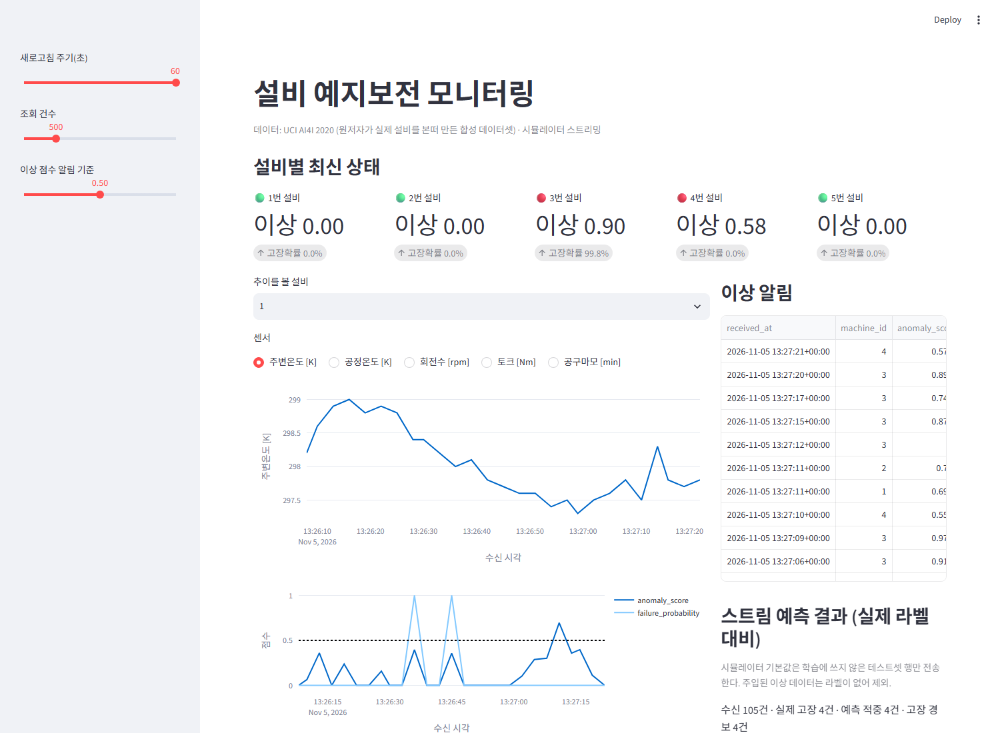
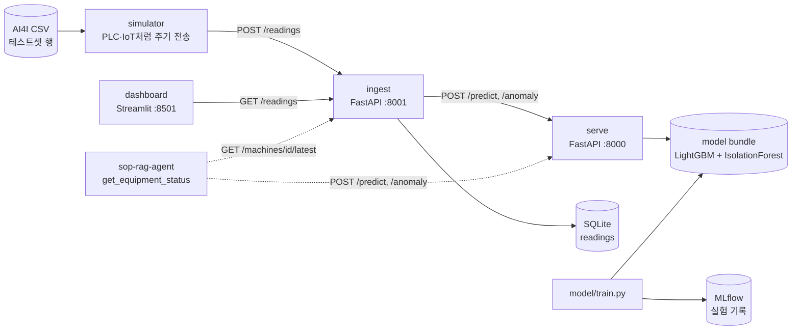

# factory-pdm — 설비 센서 이상탐지·고장 예측 (예지보전)

> PLC·IoT 센서 스트림을 수집하고, **고장 확률·고장 유형·이상 점수**를 실시간으로 계산해서 대시보드와 API로 제공하는 예지보전 파이프라인입니다.
> 모든 수치는 이 저장소 코드를 실제로 실행해서 측정한 값입니다(근거: `model/reports/metrics.json`, `model/reports/latency.json`).

**핵심 결과 (테스트셋 2,000건, 고장 68건)**

| 모델 | PR-AUC | Recall | Precision | F1 |
|---|---|---|---|---|
| LightGBM + 클래스 가중치 (서빙 모델) | **0.890** | 0.824 | 0.949 | **0.882** |
| 같은 모델, 재현율 우선 임계값 | — | **0.912** | 0.328 | 0.482 |
| Isolation Forest (비지도, 정상 데이터만 학습) | 0.191 | 0.235 | 0.286 | 0.258 |



---

## 1. 문제 정의

- **상황**: CNC 가공 설비가 갑자기 멈추면 생산이 멈추고, 고장 뒤에 고치면 비용이 큽니다. 고장 **전에** 신호를 잡아서 계획 정비로 바꾸는 것이 목표입니다.
- **풀려는 질문 세 가지**
  1. 지금 센서값으로 볼 때 **고장이 날 확률**은? (지도학습, 이진 분류)
  2. 고장이라면 **어떤 유형**인가? (공구 마모 TWF / 방열 HDF / 전력 PWF / 과부하 OSF) → 어떤 SOP를 따를지 정해짐
  3. 라벨이 없어도 **평소와 다른 패턴**인가? (비지도 이상탐지, 이상 점수 0~1)
- **평가 기준**: 고장은 전체의 3.4%뿐인 **불균형 문제**라서 정확도(accuracy)는 의미가 없습니다(전부 '정상'이라고 해도 96.6%). 그래서 **PR-AUC, Recall, F1, confusion matrix**로 평가합니다.

## 2. 데이터

- **UCI AI4I 2020 Predictive Maintenance Dataset** (10,000행, 고장 339건 = 3.39%)
  - 출처: <https://archive.ics.uci.edu/dataset/601/ai4i+2020+predictive+maintenance+dataset>
  - ⚠️ **합성 데이터**입니다. 원저자(Matzka, 2020)가 실제 예지보전 데이터를 본떠 **생성한 데이터셋**이고, 실제 공장에서 수집한 값이 아닙니다.
- 컬럼: 제품 등급(L/M/H), 주변온도 [K], 공정온도 [K], 회전수 [rpm], 토크 [Nm], 공구 사용시간 [min], 고장 여부, 고장 유형 플래그 5개
- 원본에는 설비 번호가 없어서, 시뮬레이터가 행을 1~5번 설비에 돌아가며 배정합니다.
- 내려받기: `python scripts/download_data.py` (데이터 파일은 git에 넣지 않음)

**피처 엔지니어링** (`model/features.py`, 학습·서빙이 같은 함수를 씀)

| 파생 피처 | 식 | 의미 |
|---|---|---|
| `temp_diff_k` | 공정온도 − 주변온도 | 작으면 열이 안 빠짐 → HDF |
| `power_w` | 토크 × 회전수 × 2π/60 | 너무 작거나 크면 PWF |
| `strain_min_nm` | 공구 사용시간 × 토크 | 크면 과부하 → OSF |
| `type_L/M/H` | 원-핫 | 제품 등급별 한계가 다름 |

## 3. 아키텍처



| 폴더 | 역할 |
|---|---|
| `simulator/` | 데이터 행을 일정 간격으로 수집 API에 전송. `--inject-fault 3`이면 3번 설비에 과부하 패턴(토크↑·회전수↓·공구마모↑)을 주입 (데모용, 라벨 없음) |
| `ingest/` | 센서 1건을 받아 SQLite에 저장. serve가 살아 있으면 예측·이상 점수도 같이 저장하고, 죽어 있으면 **저장은 계속**함 |
| `model/` | 피처 엔지니어링, 3개 분류기 + 이상탐지 비교, 고장 유형 분류, MLflow 기록 |
| `serve/` | `/predict`(고장 확률·유형), `/anomaly`(이상 점수), `/health` |
| `dashboard/` | 설비별 최신 상태, 센서 추이, 이상 알림, 스트림 예측 결과 |
| `tests/` | pytest 11개 (피처, 모델 성능 하한, API 스키마·오류 처리, 수집 저장) |

## 4. 실험 결과 (실측)

- 분할: train 6,000 / val 2,000 / test 2,000 (고장 비율 유지 층화 분할, seed 42)
- **임계값은 검증셋에서만 정하고**, 아래 수치는 모두 테스트셋 결과입니다.
- 모든 실행은 MLflow에 기록됩니다 (`mlflow ui --backend-store-uri sqlite:///mlflow.db`).

### 4-1. 고장 여부 분류 — 운영점 ① 검증 F1 최대 임계값

| 모델 | 불균형 처리 | PR-AUC | ROC-AUC | Precision | Recall | F1 | TN / FP / FN / TP |
|---|---|---|---|---|---|---|---|
| 로지스틱 회귀 | class_weight=balanced | 0.448 | 0.934 | 0.551 | 0.397 | 0.462 | 1910 / 22 / 41 / 27 |
| LightGBM | 없음 | 0.887 | 0.968 | 0.918 | 0.824 | 0.868 | 1927 / 5 / 12 / 56 |
| **LightGBM** | **scale_pos_weight ≈ 28.5** | **0.890** | **0.977** | **0.949** | 0.824 | **0.882** | 1929 / 3 / 12 / 56 |
| Isolation Forest | (비지도, 정상만 학습) | 0.191 | 0.847 | 0.286 | 0.235 | 0.258 | 1892 / 40 / 52 / 16 |

### 4-2. 운영점 ② 재현율 우선 (검증 Recall ≥ 0.9가 되는 가장 높은 임계값)

예지보전에서는 고장을 **놓치는 비용(FN)**이 오경보(FP)보다 훨씬 큰 경우가 많아서, 같은 모델에 두 번째 운영점을 둡니다.

| 모델 | Precision | Recall | F1 | TN / FP / FN / TP |
|---|---|---|---|---|
| 로지스틱 회귀 | 0.108 | 0.926 | 0.193 | 1409 / 523 / 5 / 63 |
| LightGBM (가중치 없음) | 0.307 | 0.897 | 0.457 | 1794 / 138 / 7 / 61 |
| **LightGBM (가중치)** | 0.328 | **0.912** | 0.482 | 1805 / 127 / 6 / 62 |

→ 놓치는 고장을 12건에서 6건으로 줄이는 대신 오경보가 3건에서 127건(테스트 2,000건 중 6.4%)으로 늘어납니다. **어느 운영점을 쓸지는 현장의 정비 인력과 다운타임 비용으로 정할 문제**라서 서빙 기본값은 운영점 ①로 두었습니다.

### 4-3. 고장 유형 분류 (테스트셋 고장 68건)

- Accuracy **0.941**, Macro-F1 **0.843**
- RNF(무작위 고장)와 플래그가 없는 고장은 센서로 설명할 수 없어서 `OTHER`로 묶었습니다.

| 실제 \ 예측 | TWF | HDF | PWF | OSF | OTHER |
|---|---|---|---|---|---|
| TWF | 7 | 0 | 0 | 2 | 1 |
| HDF | 0 | 29 | 0 | 0 | 0 |
| PWF | 0 | 0 | 12 | 0 | 0 |
| OSF | 0 | 0 | 0 | 15 | 0 |
| OTHER | 1 | 0 | 0 | 0 | 1 |

### 4-4. 엔드투엔드 스트림 검증

시뮬레이터로 **테스트셋 2,000행 전체**를 수집 API에 흘려보낸 뒤 SQLite에 저장된 예측을 집계했습니다(3번 설비 400행은 이상 주입 데이터라 라벨이 없어서 제외).

| 구간 | 결과 |
|---|---|
| 라벨 있는 1,600행 | TN 1543 / FP 2 / FN 11 / TP 44 → Recall 0.800, Precision 0.957 (오프라인 평가와 같은 수준) |
| 이상 주입한 3번 설비 400행 | 평균 이상 점수 0.832, 0.7 이상 351건, 0.9 이상 135건 |
| 정상 설비 1,600행 | 평균 이상 점수 0.144, 0.7 이상 21건, 0.9 이상 0건 |

### 4-5. 서빙 지연 (로컬 Windows PC, `scripts/bench_latency.py`, 각 200회)

| 엔드포인트 | p50 | p95 |
|---|---|---|
| `POST /predict` | 24.6 ms | 36.0 ms |
| `POST /anomaly` | 72.0 ms | 104.0 ms |
| `POST /readings` (저장 + 예측 + 이상 점수) | 115.7 ms | 139.5 ms |

### 결과 해석

- **불균형 처리 효과**: 가중치를 준 LightGBM은 가중치 없는 모델보다 PR-AUC가 0.887에서 0.890으로, 오경보가 5건에서 3건으로 개선됐습니다. 차이가 크지 않은 건 트리 모델이 임계값 조정만으로도 불균형에 꽤 강하기 때문입니다. 대신 **임계값을 검증셋에서 따로 정한 것**이 큰 역할을 했습니다.
- **선형 모델의 한계**: 로지스틱 회귀의 PR-AUC가 0.448에 그친 이유는, AI4I의 고장 규칙이 "온도차 < 8.6 K **이고** 회전수 < 1,380"처럼 **조건이 겹치는(비선형) 구조**이기 때문입니다.
- **이상탐지(IF)의 위치**: PR-AUC가 0.191로 지도학습보다 훨씬 낮지만, 라벨 없이 학습했다는 점을 감안해야 합니다. 신규 설비처럼 **고장 라벨이 아직 없는 상황**에서 쓰는 1차 방어선으로 두고, 라벨이 쌓이면 지도학습으로 넘어가는 구성입니다.
- **이상 점수 보정**: Isolation Forest 원점수는 해석이 어려워서 **정상 학습 데이터 분위수 기준**으로 0~1에 매핑했습니다 (정상 p50 → 0, p99 → 0.7, p99.9 → 0.9). 그래서 "0.9 이상"은 "정상 데이터 1,000건 중 1건보다 더 드문 값"이라는 뜻입니다.

## 5. 실행 방법 (Windows, Python 3.11)

```powershell
cd factory-pdm
py -3.11 -m venv .venv
.venv\Scripts\activate
pip install -r requirements.txt

python scripts\download_data.py     # 데이터 내려받기
python -m model.train                # 학습 + MLflow 기록 + model\artifacts\bundle.joblib 생성
pytest -q                            # 테스트 11개

# 터미널 4개에서 각각 실행
uvicorn serve.app:app --host 127.0.0.1 --port 8000
uvicorn ingest.app:app --host 127.0.0.1 --port 8001
streamlit run dashboard\app.py
python -m simulator.stream --interval 0.5 --inject-fault 3

# 확인
curl -X POST http://127.0.0.1:8000/predict -H "content-type: application/json" `
  -d '{\"product_type\":\"L\",\"air_temp_k\":302,\"process_temp_k\":310.5,\"rpm\":1180,\"torque_nm\":68,\"tool_wear_min\":220}'
mlflow ui --backend-store-uri sqlite:///mlflow.db   # 실험 기록 보기
```

Docker 사용 시: `docker compose up --build` (serve·ingest·simulator·dashboard 4개 서비스, 이미지 빌드 중에 데이터 다운로드와 학습까지 수행). 로컬 Docker Desktop에서 4개 컨테이너 기동과 /health 응답까지 확인했습니다.

> Windows에서는 `localhost` 대신 `127.0.0.1`을 쓰세요. `localhost`가 IPv6(::1)를 먼저 시도해서 요청마다 약 2초가 늦어지는 현상을 실제로 겪었습니다 (`DECISIONS.md` 참고).

## 6. 한계와 다음 단계

**한계**
- **합성 데이터**: AI4I는 고장 규칙이 비교적 깔끔하게 만들어진 데이터라 실제 현장 데이터보다 점수가 높게 나올 가능성이 큽니다.
- **시계열 정보 미사용**: 행마다 독립적으로 예측합니다. 실제 PLC 데이터라면 이동평균, 변화율, 진동 스펙트럼 같은 **시간 축 피처**와 RUL(잔여수명) 예측이 필요합니다.
- **고장 유형 평가 표본이 작음**: 테스트셋 고장이 68건뿐이라 유형별 수치(특히 TWF 10건, OTHER 2건)는 분산이 큽니다.
- **모델 선택**: 서빙 모델(가중치 LightGBM)은 미리 정해 둔 것입니다. 엄밀하게 하려면 검증셋 기준으로 고르거나 교차검증으로 비교해야 합니다.
- 인증, 데이터 보존 정책, 드리프트 모니터링은 아직 없습니다.

**다음 단계**
1. 시간 창(window) 피처 + RUL 회귀 모델 (예: NASA C-MAPSS로 검증)
2. 예측 분포 드리프트 감지 → 재학습 트리거 (MLflow Model Registry 연동)
3. 실제 PLC 연동: OPC UA / MQTT 게이트웨이 → 수집 API
4. MES 정비 작업지시 자동 발행 연동 (sop-rag-agent의 조치 안내와 연결)

## 관련 프로젝트

- [sop-rag-agent](https://github.com/mingdevu/sop-rag-agent): 이 프로젝트의 `/predict`·`/anomaly`를 도구로 호출해서 "3번 설비 이상 점수가 높은데 어떻게 조치해?" 같은 질문에 SOP 근거로 답하는 에이전트
